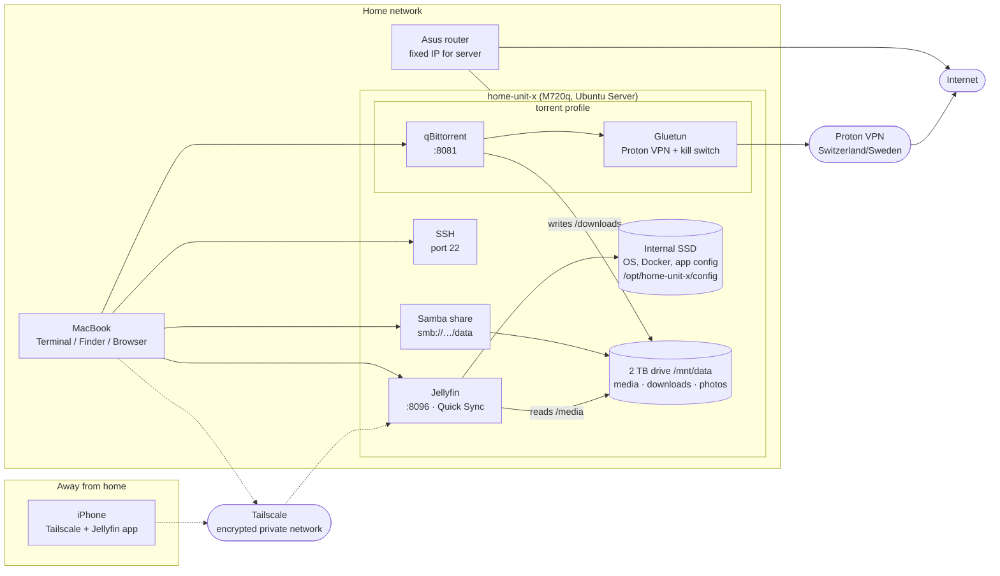

# home-unit-x – Handbook

How to use everything that's set up so far. For a command cheat sheet, see [commands.md](commands.md). For what's done and what's next, see [build-plan.md](build-plan.md).

## Overview



- **Normal traffic** (Jellyfin, Samba, SSH) uses the home internet connection.
- **qBittorrent traffic** only goes through Proton VPN. If the VPN is down, qBittorrent has no internet.
- **Nothing is open to the internet.** Remote access only works through Tailscale.

## Addresses

| What | At home | Away (Tailscale on) |
|---|---|---|
| SSH | `ssh home-unit-x` | `ssh <user>@home-unit-x` |
| Jellyfin | `http://home-unit-x.local:8096` | `http://home-unit-x:8096` |
| qBittorrent | `http://home-unit-x.local:8081` | `http://home-unit-x:8081` |
| Files (Finder, ⌘K) | `smb://home-unit-x.local/data` | `smb://home-unit-x/data` |
| Tailscale admin | login.tailscale.com/admin/machines | same |
| Router admin | `http://<router-ip>` (see sticker / System Settings → Wi-Fi → Details → TCP/IP) | – |

If `.local` doesn't work, use the server's IP address. Always type `http://`; if Chrome forces https, use Safari or a private window.

## Where things live

| Path on the server | Contents |
|---|---|
| `~/home-unit-x` | This repo: `docker-compose.yml`, `.env`, scripts, docs |
| `~/home-unit-x/.env` | Settings **and secrets** (WireGuard key). Never commit it |
| `/opt/home-unit-x/config/` | App settings and databases (Jellyfin, qBittorrent, Gluetun) |
| `/mnt/data/media/{movies,tv,music}` | Jellyfin libraries (`/media/...` inside Jellyfin) |
| `/mnt/data/downloads` | qBittorrent downloads (`/downloads` inside qBittorrent) |
| `/mnt/data/photos`, `nextcloud`, `games` | Reserved for later apps |

Keep these in your password manager: server password, Samba password, Jellyfin admin, qBittorrent login, and the Proton WireGuard key.

---

## 1. Connect to the server

1. Open Terminal on the Mac.
2. Run `ssh home-unit-x`. Your key passphrase is stored in the macOS Keychain, so no password is needed.
3. Run `exit` to leave.

Away from home, turn on Tailscale on the Mac first.

## 2. Add media

1. In Finder, press **⌘K** and enter `smb://home-unit-x.local/data`. Log in with your server username and the **Samba password**.
2. Copy files into `media/movies`, `media/tv` or `media/music`, using this naming:
   ```
   movies/Movie Name (2010)/Movie Name (2010).mkv
   tv/Show Name/Season 01/Show Name S01E01.mkv
   ```
3. Jellyfin picks the files up automatically. To make it look right away, go to **Dashboard → Libraries → Scan All Libraries**.

Large copies from the Mac are limited by the network (currently ~11 MB/s, see build plan Phase 5).

## 3. Watch

- **At home:** use the Jellyfin app on a TV or phone, or a browser at `http://home-unit-x.local:8096`.
- **Away:** turn on Tailscale on the phone, then use the Jellyfin app with server `http://home-unit-x:8096`.
- **Quality:** use the ⚙ icon in the player. Lower bitrates make the server transcode, using hardware via Quick Sync.

## 4. Download with qBittorrent (via VPN)

1. Open `http://home-unit-x.local:8081` and log in.
2. Add a torrent file or magnet link. Files are saved to `downloads/`.
3. When it's finished, **move** (don't copy) the file into `media/movies` or `media/tv` in Finder. On the same drive this is instant.

Only download content you have the right to.

**Check that the VPN is active** (whenever you want to be sure):
```sh
docker exec gluetun wget -qO- https://ipinfo.io
```
It should show a Proton IP, never your home IP.

**Check the forwarded port.** If the latest port in the log doesn't match qBittorrent → Options → Connection, see Troubleshooting.
```sh
docker compose logs gluetun | grep -i "port forward" | tail -n 1
```

### 4.1 Torrent checklist

**One-time setup**
- [ ] qBittorrent → Options → Downloads → **Excluded file names**. Turn it on and add:
  ```
  *.exe
  *.msi
  *.bat
  *.cmd
  *.com
  *.scr
  *.vbs
  *.js
  *.ps1
  *.lnk
  *.dmg
  *.pkg
  *.app
  ```
  These files are skipped automatically, even if they're inside a torrent.
- [ ] Optional virus scanner on the server: `sudo apt install -y clamav`. Virus definitions update automatically via the `clamav-freshclam` service (check with `systemctl status clamav-freshclam`; don't run `freshclam` manually while it's running)

**Before adding a torrent**
- [ ] **VPN is active:** `docker exec gluetun wget -qO- https://ipinfo.io` shows a Proton IP
- [ ] **Trusted source:** a known site and a known or verified uploader, not a random search result or pop-up link
- [ ] **Healthy torrent:** plenty of seeders and positive comments. No comments, or "fake"/"virus" comments, means skip it
- [ ] **Realistic size:** 1080p movie ~2–10 GB, 4K ~20–60 GB, TV episode ~0.3–3 GB. Much smaller than that is usually fake
- [ ] **Check the file list before downloading** (qBittorrent shows it when you add the torrent). Expect video files (`.mkv`, `.mp4`, `.avi`) and maybe subtitles (`.srt`) and images (`.jpg`/`.nfo`)

**Red flags: cancel and delete**
- [ ] Executable or script files (see the list above), or **double extensions** like `Movie.mp4.exe` or `Movie.mkv.lnk`
- [ ] A movie delivered as `.zip`, `.rar` or `.7z`, especially **password-protected** archives ("password in readme / on website")
- [ ] Instructions to download a **"codec"**, "player" or "key" to watch it
- [ ] A movie that's still in cinemas but "already in 4K", or a file name stuffed with keywords

**After downloading**
- [ ] Optional scan: `clamscan -r -i /mnt/data/downloads` (`-i` lists only infected files)
- [ ] Play it **in Jellyfin**, not by opening the file on the Mac
- [ ] Never run, install or "open with" anything that came from a torrent
- [ ] **Move** (don't copy) good files to `media/movies` or `media/tv`, and **delete** anything suspicious
- [ ] Remove finished torrents in qBittorrent once you're done seeding (right-click → Remove; choose whether to keep the files)

Video files (`.mkv`, `.mp4`) can't run code by themselves; the danger is almost always a disguised program or archive. Only download content you have the right to.

## 5. See what's running

| Tool | Command | Shows |
|---|---|---|
| lazydocker | `lazydocker` | All containers, logs, CPU/RAM; `s` stop, `r` restart, `q` quit |
| Docker | `docker ps` | Running containers. "(healthy)" only appears for Jellyfin and Gluetun; qBittorrent shows "Up" |
| Whole server | `htop` | CPU, memory and processes |
| Disk space | `df -h /mnt/data` | Free space on the media drive |
| Quick Sync | `sudo intel_gpu_top` | The **Video** row shows activity during a transcode |

## 6. Start and stop apps

Run these in `~/home-unit-x`:

| Task | Command |
|---|---|
| Start Jellyfin | `docker compose up -d` |
| Start everything including VPN + qBittorrent | `docker compose --profile torrent up -d` |
| Stop everything | `docker compose --profile torrent down` |
| Restart one app | `docker restart jellyfin` |
| Show logs | `docker compose logs -f jellyfin` (`Ctrl+C` to stop) |

To skip typing `--profile torrent` every time, add `COMPOSE_PROFILES=torrent` to `.env`.

**After restarting Gluetun manually**, also restart qBittorrent once Gluetun shows "(healthy)":
```sh
docker restart gluetun
docker restart qbittorrent
```

## 7. Shut down and start the server

- **Shut down:** `sudo shutdown now`, or a short press on the power button. Containers and the drive are stopped safely.
- **Start:** press the power button. Docker starts every app that was running before. The BIOS is also set to power on automatically after a power cut.
- Don't hold the power button or pull the cable unless the server has frozen.
- Unplugging the drive while the server is running: first `docker compose --profile torrent down`, then `sudo umount /mnt/data`.

## 8. Keep things updated

| What | How |
|---|---|
| Ubuntu security updates | Automatic (`unattended-upgrades`) |
| All Ubuntu packages | `sudo apt update && sudo apt upgrade -y`, then `sudo reboot` if `/var/run/reboot-required` exists |
| Apps (Docker images) | `cd ~/home-unit-x && docker compose --profile torrent pull && docker compose --profile torrent up -d`, then `docker image prune` |
| Repo changes from the Mac | Mac: `git add . && git commit -m "..." && git push`. Server: `cd ~/home-unit-x && git pull` |
| lazydocker | Re-run its install command |

## 9. Network checks

| Check | Command | Expected |
|---|---|---|
| Internet speed | `speedtest-cli` | ~92/92 Mbit/s (100/100 subscription) |
| Ethernet link | `cat /sys/class/net/e*/speed` | `1000`; currently `100`, which limits local copies only |
| Server IP | `hostname -I` | Same IP every time (reserved in the router) |
| Tailscale | `tailscale status` | Lists your devices |

---

## Troubleshooting

| Problem | Fix |
|---|---|
| `ssh home-unit-x` hangs | Check the IP with `hostname -I` on the server; turn off any work VPN on the Mac; try `ssh <user>@<ip>` |
| Server password not accepted | Recovery mode: Esc **once** at boot → Advanced options → recovery mode → root → `mount -o remount,rw /` → `passwd <user>` → `reboot`. At a `grub>` prompt, type `reboot` and try again |
| Browser shows `ERR_SSL_PROTOCOL_ERROR` | Type `http://` explicitly, or use Safari or a private window |
| Jellyfin keeps "Restarting" | `docker compose logs jellyfin`. If you see `UnauthorizedAccessException`: `sudo chown -R $USER:$USER /opt/home-unit-x/config` and `docker compose up -d` |
| Jellyfin "fatal player error" | Check that the file really is a video: `file <path>`. Try Hardware acceleration → None to rule out Quick Sync |
| qBittorrent says "Unauthorized" | Host port and `WEBUI_PORT` must match (both 8081); `git pull` and `docker compose --profile torrent up -d --force-recreate` |
| qBittorrent port ≠ forwarded port | Enable "Bypass authentication for clients on localhost", then restart gluetun and, once healthy, qbittorrent |
| qBittorrent web UI dead | Gluetun is probably down or reconnecting (kill switch working). Check `docker ps`, then restart gluetun and then qbittorrent |
| "Permission denied" creating folders on `/mnt/data` | `sudo mkdir -p <folder> && sudo chown $USER:$USER <folder>` |
| `.local` names don't work | Use the IP address; check that `avahi-daemon` is running: `systemctl status avahi-daemon` |
